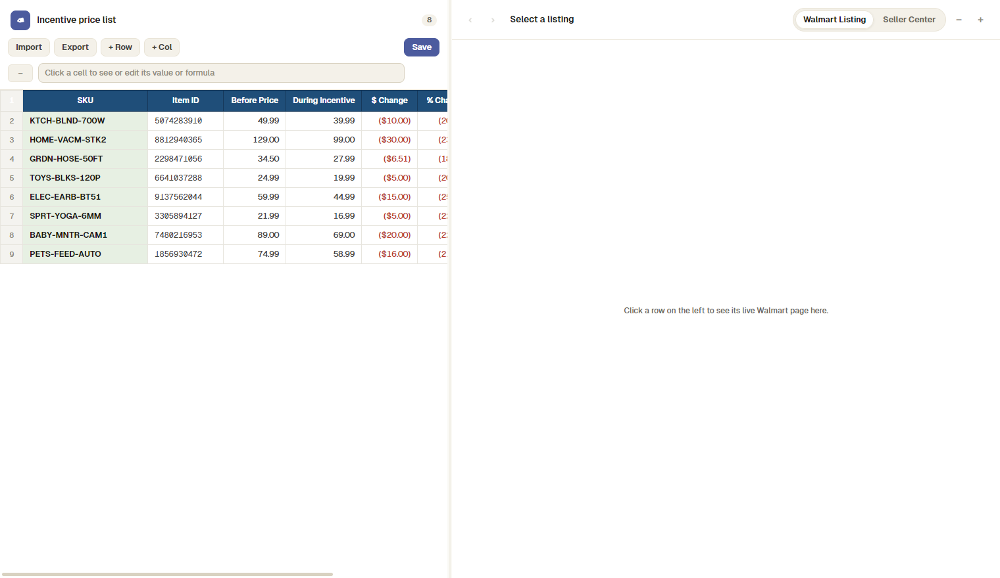

<div align="center">
  
  <h1>Walmart Listing Browser</h1>
  <p><b>Spreadsheet-style incentive price list with live Walmart listing browsing.</b></p>
  <p><b>⬇ Download the latest installer:</b> <a href="../../releases/latest"><b>macOS (.dmg)</b></a> · <a href="../../releases/latest"><b>Windows (.exe)</b></a></p>
</div>



Keep an incentive price sheet on the left, and click any row to see its **live walmart.com listing** docked on the right — no tab-juggling between a spreadsheet and a browser.

## Features

- **Spreadsheet UI** — editable cells, formulas (`=D2-C2`), always-on search bar (Ctrl+F), sortable columns, drag-to-reorder rows, custom columns.
- **Live listing pane** — the real walmart.com product page for the selected row, docked beside the sheet, with zoom and prev/next navigation.
- **Buy-box suggestion** — after a listing loads, Walmart's current price appears as a ghost value in the selected row's During Incentive cell (with a % Change preview while the row is blank, or as a small tag next to an existing price). Press Enter on that cell or click the tag to use it; it's then an ordinary value you can still edit. This keeps working with the pane closed: the listing loads off-screen and the cell shows a spinner while it reads. Click a suggestion pill for a card with the price, when it was read, your During vs the buy box, a Use button to confirm, and a **Look for other sellers** button that fetches the other offers' prices on request (your own store marked YOU once you name it). The lookup runs in the hidden worker, never in the pane you're reading. **Hide suggestions** in the toolbar clears all scan marks from the sheet (nothing is lost; click again to bring them back).
- **Scan buy boxes** — one toolbar button walks every listing through the off-screen Walmart view (one at a time, images and media skipped, a third of a second apart), remembers each buy box on its row, and shows suggestions on every row. Rows read in the last 24 h are skipped, so a scan after a restart only visits what's missing or stale (Shift+click to re-read everything). Buy boxes follow the item ID: import or paste a new list and rows whose item IDs were already scanned keep their reads, so the next scan only visits the new ones. All of this runs in a hidden worker view, so the listing pane stays usable during a scan. Click again to stop; the button then offers **Resume** (continue where it left off) with a **Start over** beside it. **Apply N suggestions** then writes all pending During / Before values in one undoable step, so you approve first and check after.
- **Before-price suggestion** — when a row has a During price but no Before, the Before cell ghosts the smallest .99 price at least 4.1% above it (Walmart needs ≥4% off for the commission break); Enter accepts. Existing Before values are never changed, but any row under 4% gets an amber % Change cell.
- **Closable pane** — the × in the pane header closes the right side so the sheet takes the full window; "Show listing pane" in the toolbar brings it back (remembered between launches).
- **Walmart Listing ⇄ Seller Center toggle** — flip the pane between the customer-facing listing and a free-browsing Seller Center session (sign in once; loads once; row clicks never disturb it).
- **Row auto-jump** — browse to another listing or variant inside the pane and the sheet selects that row automatically.
- **Import** — pull rows in from `.xlsx` / `.csv` / `.tsv`, or paste straight from Google Sheets with Ctrl+V; optional per-row commission columns are picked up by header name.
- **Auto-update** — the app checks the latest GitHub Release on launch (and every few hours); click the version tag in the header to check by hand (a small popover, the page never moves). Windows downloads and installs the new version in-app. macOS downloads the release's `.zip` build itself and swaps the app bundle on restart, so there is no Gatekeeper / Privacy & Security step; if the app runs from the mounted `.dmg` it offers the `.dmg` download instead.
- **Export** — the regular sheet (live formulas), Walmart's Repricer Bulk Upload file, or the Account Manager's "Item & Partner Level Comm Break" template — their exact file, filled with one row per Item ID (Base ID = Item ID, partner ID, commission rates, prices, incentive dates) and revealed in Finder / Explorer ready to email.
- **Market tab** — Walmart buy box and Amazon buy box side by side for every SKU. *Run buy box check* reads every listing's Walmart page for the **buy box price, who holds it, and every other seller** (see *Buy box check* below). With your seller API keys saved behind the **API** button, the scan also pulls every SKU's win rate, competitor and suggested price from the **Walmart Marketplace API** (Pricing Insights) in one batched call; the API has no seller names, so the pages are read either way. Every Amazon listing linked to a row is read page by page as before, and the scan can run by itself every few hours. Link any number of Amazon listings per SKU by URL or ASIN, or type a price in by hand. **Linnworks** imports the Linnworks SKU export (its *Mappings* sheet): Walmart SKUs that belong to one Linnworks SKU become a group — a parent line in the table, one shared set of Amazon links (link once, it counts for every Walmart SKU in the group), and the sibling SKUs listed in the panel. Click a row for all sellers and listings; when the scan finishes, a pop-up lists the SKUs Amazon undercuts, biggest gap first, ready to export as CSV or Excel. The Incentive price list tab holds no scanning any more — it is just the price sheet.
- **Buy box check** — the Market scan does the whole Walmart price check by itself. (1) It reads the items of one **repricer strategy** (default `IMRAN BUY BOX 2`, name configurable): SKU, item ID, price, min, max, inventory and status — from the Walmart API when keys are saved, otherwise from the signed-in Seller Center page, or from a report file you download. This is strictly read-only: nothing in Seller Center is ever changed (the app only loads, scrolls and pages through the list). Strategy items missing from the price list are added as plain rows (SKU and Item ID only). (2) For **every** item it opens the listing off-screen, opens *Compare all sellers* and records each seller's name, price, shipping and total, ranks them, and marks your store **YOU** with your rank (`#2 of 7`). (3) It saves a **screenshot of the full seller list** per item per scan — one tall image however long the list is; with a single seller or an out-of-stock listing it captures the buy box instead. The picture shows in the row's panel (click to open full size). (4) It repeats **every N hours** (default 3) while the app is open; **Stop** keeps the scan's place and **Resume** carries on (or *Start over*). A Walmart robot check pauses the scan instead of failing every remaining row. (5) After each scan it writes a **JSON results file** for other apps (format below). All of it is set under **Check settings** on the Market tab.
- **Room to raise** — Walmart's repricer lowers your price to win the buy box but never raises it back, so when the seller you were matching sells out you keep a low price with the next seller far above. After each scan, every listing where you hold the buy box and the cheapest other seller is far enough above you gets a *↑ $X room* tag, a *Room to raise* filter chip counts them, the side panel shows the next seller and a suggested price (with Copy), and the end-of-scan pop-up lists them with CSV / Excel export (it also says how many buy boxes you hold and have lost). **Raise rules** sets what counts — a minimum gap in $ and/or % — and the suggestion: how far under the next seller ($ or %), an optional cap on one raise, and optional rounding down to .99. The market sheet export carries Next Seller, Next Seller Price and Raise To columns.
- **Auto-computed columns** — `$ Change` and `% Change` recompute from Before / During prices.
- **Local-first** — everything is stored in a local JSON file; no accounts, no server.

## Getting started

```bash
npm install
npm start
```

### Build the Windows installer

```bash
npm run dist
```

The branded NSIS installer lands in `dist/Walmart-Listing-Browser-Setup-<version>.exe`.

### Build the macOS app

Run this **on a Mac** (a `.dmg` can only be built on macOS):

```bash
npm install
npm run dist:mac
```

The disk image lands in `dist/Walmart-Listing-Browser-<version>-universal.dmg`. Open it and
drag the app into **Applications** — from then on it's a normal double-click app.
It isn't code-signed, so the first launch shows an "unidentified developer"
warning: right-click the app → **Open** → **Open**, and macOS remembers it.

## Import format

The first four columns of your sheet, in this order (a header row is fine — it's skipped):

| A | B | C | D |
|---|---|---|---|
| SKU | Item ID | Before Price | During Incentive |

Only SKU is required — Item ID and prices can be left blank. Extra columns (`$ Change`, `% Change`, …) are ignored on import and recomputed in-app.

Need a starting point? The import dialog has a **Download a blank template** link that saves an `.xlsx` with these headers and an example row.

Optionally add `Regular Commission` and `During Incentive Commission` columns (any position — they're matched by header name). Rows without them default to 6% / 2%; the values fill the commission rate columns in the Account Manager export.

## Buy box results file

After every scan (finished or stopped, and after a single-row re-check) the app writes `walmart-buybox-latest.json` to the folder chosen under **Market → Check settings** (default: `buybox-export` inside the app's data folder). It is written to a temporary name and renamed, so a reader never sees half a file. A copy of each scan's file is kept as `scan.json` next to that scan's screenshots.

The format is versioned by `schema`; fields are only ever added within `walmart-buybox/1`.

```jsonc
{
  "schema": "walmart-buybox/1",
  "app": { "name": "Walmart Listing Browser", "version": "0.6.0" },
  "generatedAt": "2026-11-26T14:05:31.000Z",   // when this file was written (ISO 8601, UTC)
  "scanId": "2026-11-26_09-01-12",             // also the screenshot folder's name
  "scanStartedAt": "2026-11-26T14:01:12.000Z",
  "scanFinishedAt": "2026-11-26T14:05:31.000Z",
  "scanComplete": true,                        // false: the scan was stopped, or only one row was re-checked
  "store": "Digital World Shop",               // your store name, as matched against sellers
  "strategy": "IMRAN BUY BOX 2",
  "repricerList": { "source": "api", "readAt": "2026-11-26T14:01:20.000Z", "items": 62 },  // source: api | seller | file
  "screenshotsFolder": "C:\\Users\\…\\buybox-shots",
  "rows": [ /* one per SKU, see below */ ]
}
```

Each row:

| Field | Type | Meaning |
|---|---|---|
| `sku` | string | Your SKU. |
| `itemId` | string | Walmart item ID (`""` if unknown). |
| `strategy` | string \| null | Repricer strategy the SKU is on (null for a row that isn't on the strategy). |
| `myPrice` | number \| null | Your price: from the repricer list, else your offer on the listing, else the API, else the price sheet. |
| `minPrice`, `maxPrice` | number \| null | The repricer's min and max for the SKU. |
| `inventory` | number \| null | Inventory from the repricer list. |
| `status` | string \| null | Status from the repricer list (repricer status when given, else the item's status). |
| `buyBoxPrice` | number \| null | Buy box item price on the listing. |
| `buyBoxSeller` | string \| null | Who holds the buy box. |
| `buyBoxIsMine` | boolean \| null | Whether that is your store (null when it couldn't be told). |
| `myRank` | number \| null | Your place among the sellers, 1 = cheapest by `total`. Null when your offer isn't on the listing. |
| `sellerCount` | number | Sellers read on the listing. |
| `lowestCompetitorPrice`, `lowestCompetitorShipping`, `lowestCompetitorTotal`, `lowestCompetitorSeller` | number / string \| null | The other seller with the lowest `total`. |
| `gap` | number \| null | Your total minus the lowest competitor's total. Positive: you are more expensive by that much; negative: you are cheaper. |
| `outOfStock` | boolean \| null | The listing said out of stock. |
| `sellers` | array | Every seller, cheapest total first: `{ rank, seller, price, shipping, shippingNote, total, isMe, hasBuyBox }`. `shipping` is `0` for free shipping, a number when a cost is stated, `null` when the listing doesn't state it (then `total` = `price`); `shippingNote` is the listing's delivery line. |
| `screenshot` | string \| null | Absolute path of the PNG (`<screenshotsFolder>/<scanId>/<itemId>.png`). |
| `screenshotKind` | `"sellers"` \| `"buybox"` \| null | What the picture shows. |
| `scannedAt` | string \| null | When this listing was last read (ISO 8601, UTC). |
| `readStatus` | string | `ok`, `out-of-stock`, `robot-check`, `not-found`, `failed`, `not-scanned` or `no-item-id`. Anything but `ok` means the price fields may be from an earlier read or empty. |
| `listingUrl` | string \| null | The walmart.com listing. |

Screenshots are kept for the last 24 scans.

## Tech notes

- Electron 33, plain HTML/CSS/JS renderer (no framework).
- The listing pane is a `WebContentsView` — walmart.com refuses to render into a `<webview>`, so a window-grade view is docked over the layout instead.
- Background reads (scans, seller lookups) run in a second, never-shown view that renders **offscreen**. A merely hidden view counts as a hidden page, so Chromium pauses animation frames and lazy loading there and Walmart's lazily rendered "Compare all sellers" link never appears; offscreen, the page behaves as visible, so the worker can scroll to that link, click it and read the panel.
- Seller-list screenshots are taken in that same off-screen view. It can't be resized (an off-screen view always takes the window's size), so for a list longer than the view the page's viewport is made as tall as the list for one capture (a device-metrics override); if that isn't possible the list is scrolled and the slices are stitched (`shots.js`).
- The repricer strategy's items come through one field mapper that recognises SKU / item ID / price / min / max / inventory / status by the shape of a field's name, whatever the source: Pricing Insights rows, the data a Seller Center page fetches, its visible table, or a report file (`repricerImport.js`).
- `exceljs` powers `.xlsx` import/export.
- Icon assets live in [`build/`](build/) — `icon.svg` is the master; `icon.png` / `icon.ico` are rasterized from it. `icon-mac.svg` / `icon-mac.png` place the same artwork on Apple's 1024 icon grid (tile 824 px, clear margin around it) so the Dock shows it at the same size as other Mac apps.

---

<div align="center"><sub>© 2026 Imran Tursun · Internal tool — not affiliated with or endorsed by Walmart Inc.</sub></div>
